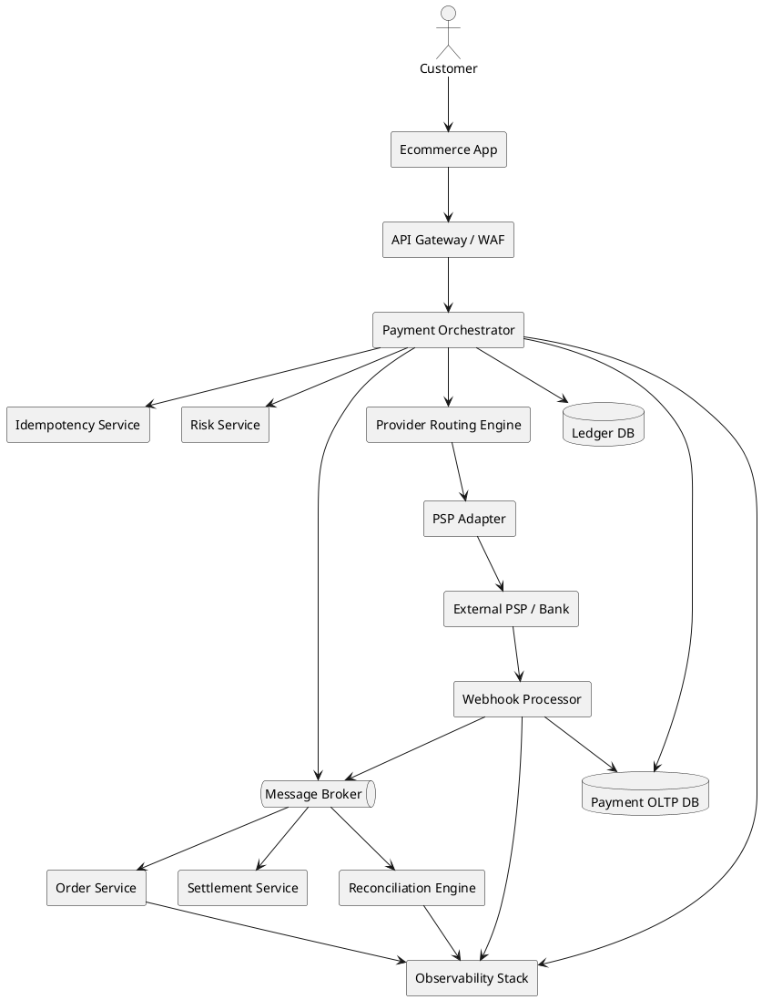

# System Architecture

## High-level architecture



## Critical synchronous path

```text
Request validation
Idempotency check
Payment intent creation
Provider initiation
Immediate response to user
```

## Async path

```text
Webhook processing
Ledger posting
Order confirmation
Notification
Reconciliation
Settlement
Analytics
```

## Component responsibilities

### Payment Orchestrator

Owns payment lifecycle, state machine, idempotency, provider routing, and event emission.

### PSP Adapter

Isolates provider-specific API contracts, authentication, signing, status mapping, and retries.

### Webhook Processor

Receives external provider events, validates signature, persists raw event, deduplicates, and triggers state transition.

### Ledger Service

Maintains append-only financial entries. No deletes. Corrections are reversals.

### Reconciliation Engine

Compares internal ledger, PSP settlement report, and bank statement.

### Settlement Service

Groups settled transactions, calculates fees/taxes, and generates merchant payout batches.

### Observability Stack

Captures metrics, logs, traces, business events, and alerts.

## Architecture decision

Customer-facing flow can be fast, but financial completion must be durable and correct.
