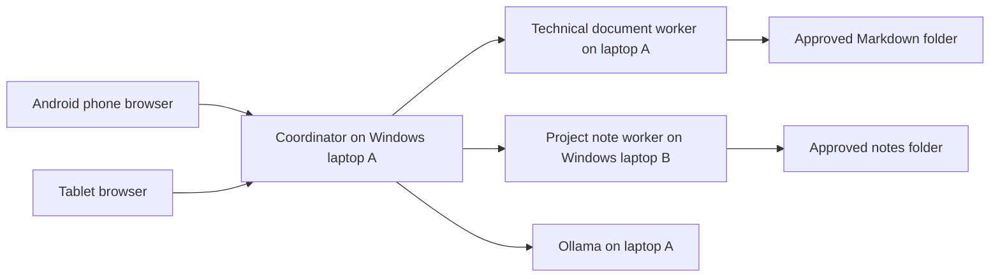

# Device Research POC — payment architecture specialization

Status: first executable increment. Two workers and coordinator tested over HTTP on one cloud host. Windows LAN deployment, real model inference, phone/tablet interaction, and answer-quality evaluation remain unverified.

## Product goal

Ask from an Android phone: “How should a payment system handle duplicate webhooks and downstream outages?” Receive a short answer with citations to approved technical documents on laptop A and project notes on laptop B. A tablet can use the same web interface. The phone is the control interface; laptop A hosts the coordinator so Android background restrictions do not interrupt jobs.

Initial specialization: idempotency, transactional outbox, payment state transitions, reconciliation, and observability. Incident logs and automated incident diagnosis belong to the subsequent POC.



The workers currently perform deterministic search, not autonomous reasoning. The coordinator is a fixed parallel workflow. This is the baseline against which a future agentic planner must demonstrate value. Do not present it as a completed multi-agent intelligence benchmark.

## Run on two Windows laptops

Prerequisite: Python 3.11 or newer on both machines. Install Ollama on laptop A from its official Windows distribution. Clone this repository on both laptops and open PowerShell in `poc\device-research`. Use the existing checkout; no worktree is needed.

Choose a random shared token of at least 24 characters using a password manager. In **each** terminal running a service, enter that same token without putting it in command history:

```powershell
$secureToken = Read-Host 'Shared research token' -AsSecureString
$env:RESEARCH_TOKEN = [System.Net.NetworkCredential]::new('', $secureToken).Password
```

Laptop A, terminal 1:

```powershell
py -3 -B assistant.py worker --host 0.0.0.0 --port 8101 --root ..\..\docs --device technical-docs
```

Laptop B, terminal 1:

```powershell
py -3 -B assistant.py worker --host 0.0.0.0 --port 8102 --root ..\..\case-studies --device project-notes
```

The sample corpus is deliberately split by directory, not replicated into both worker scopes. Later replace `--root` with a dedicated folder containing only material approved for this demo. Only `.md` and `.txt` files are indexed, hidden paths and symlink escapes are excluded, files over 1 MB are skipped. The index is a startup snapshot: restart the worker after changing source files. PDF, Office files, OCR and arbitrary whole-device search are outside this increment.

Laptop A, model setup:

```powershell
ollama pull qwen2.5:3b
ollama run qwen2.5:3b 'Reply with READY'
```

The 3B model is a starting candidate, not a hardware-validated choice. Record laptop RAM, CPU, GPU, model tag and Ollama version before measuring results. First model download and cold inference are separate from warm latency. If Ollama is not running, start it through its Windows app or `ollama serve`.

Use `ipconfig` to find each laptop's Wi-Fi IPv4 address. Laptop A, terminal 2, after setting the same token:

```powershell
$laptopB = Read-Host 'Laptop B Wi-Fi IPv4 address'
py -3 -B assistant.py coordinator --host 0.0.0.0 --port 8000 --workers http://127.0.0.1:8101 "http://${laptopB}:8102" --model-backend ollama --model qwen2.5:3b
```

For retrieval-only mode omit `--model-backend ollama --model qwen2.5:3b`.

Permit inbound TCP 8000 on laptop A and 8102 on laptop B through Windows Firewall **on the Private profile, scoped to the local subnet**. Do not disable the firewall. Keep Ollama port 11434 local to laptop A. Ensure the Wi-Fi router does not isolate clients. These instructions expose a demo HTTP server: use non-sensitive sample documents on a trusted private LAN. Bearer tokens are not encrypted over HTTP. Before using confidential files, add authenticated HTTPS with a trusted certificate; this prototype does not implement that deployment layer or per-user authorization.

On the phone/tablet, open laptop A's Wi-Fi address with port 8000 in the browser. Enter the shared token and a research question. The token stays in page memory, is not stored in browser local storage, and is not logged by the server. Close the page after use. Do not expose these ports to the public Internet.

## Cloud model option

The same coordinator supports an OpenAI-compatible chat endpoint using `--model-backend openai --model MODEL_NAME`. Set `RESEARCH_MODEL_API_KEY` securely in the process environment; do not check it into Git. The default endpoint is `https://api.openai.com/v1`; override using `--model-endpoint` for a compatible HTTPS service. Compatibility varies by model and provider; this adapter has not been verified with a live cloud API.

Cloud generation sends the question and retrieved passages to that provider. Local Ollama mode sends them only to the configured local endpoint. Workers send selected passages and citation metadata to the coordinator in both modes; no full-document endpoint exists.

## Validation and evidence

From this directory:

```powershell
py -3 -B -m unittest discover -s tests -v
py -3 -B evaluate.py
```

Eight tests exercise source boundaries, auth, malformed requests, two-worker HTTP integration, device failure, citation ID validation, empty-evidence abstention, and graceful model failure. Model responses in these tests are mocked: passing them does not prove model answer quality.

`baseline-v1-results.json` records the first retrieval attempt (3/6 expected documents found). `baseline-results.json` records the revised query-coverage scorer (6/6). Both are measured single-host simulations without an LLM. The six questions were used during development: 100% hit@6 on this set is not a general accuracy claim. Citation span matching means the returned text matches the named file and lines; it does not mean a generated claim is supported by that text. Latency excludes generation and is not Wi-Fi latency. Evidence bytes measure the serialized final evidence list, not total network traffic.

## Completion gates for the portfolio demonstration

1. Run both Windows workers and coordinator, then query successfully from phone and tablet. Save sanitized screenshots and machine/version metadata.
2. Run real local-model inference. Confirm valid citations, semantic support for claims, appropriate abstention, and no source-instruction execution. The software validates citation IDs, not semantic entailment.
3. Create at least 30 held-out questions with reviewed relevant sources, including ten unanswerable or ambiguous questions. Keep these separate from the six development questions.
4. Measure retrieval hit@6, reviewer-scored claim support, answer correctness, abstention precision/recall, end-to-end p50/p95, generation time, and true network transfer. Record cold and warm runs separately, at least 30 measured requests per configuration.
5. Compare single-worker merged-corpus retrieval against two-worker distributed retrieval using identical source content and model settings. Compare a single reasoning agent against specialist agents only after adding those agents. Do not confuse distributed retrieval with multi-agent reasoning.
6. Disconnect laptop B during a query. Verify partial results visibly identify the missing device; reconnect and repeat. Never claim a complete corpus search when a worker is unavailable.
7. Verify denied tokens and sensitive-folder exclusion on Windows; add HTTPS before testing private material. Redact documents, tokens and API keys from evidence artifacts.
8. Record failures and costs alongside successful results, then commit the final report and deploy instructions. This increment is not evidence of completed physical-device deployment.

Follow-up architecture choices: embeddings versus lexical retrieval, reranking, provenance hashes for changing files, incremental indexing, authorization per device, bounded concurrency/rate limiting, model context budgets and prompt injection evaluation. Prioritize these using measured failures rather than adding agents by default.
