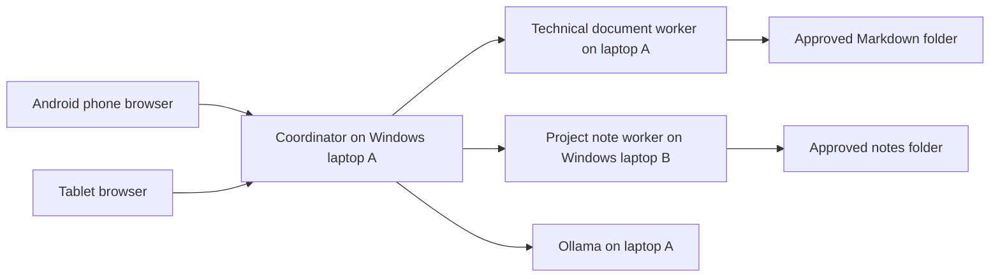

# Payment Architecture Review Lab

Status: tool-using research agent, optional reviewer, live dashboard, bounded orchestration, and OpenTelemetry export implemented. HTTP services, browser behavior, and distributed trace propagation have been tested on one cloud host. Real model inference, Windows LAN deployment, and answer quality remain unverified. See [validation evidence](VALIDATION.md).

For a short walkthrough, start with the [three-minute demo](DEMO.md). See the [workflow contract](SPEC.md) for budgets, handoffs, and observability boundaries.

## Product goal

Ask from an Android phone: “How should a payment system handle duplicate webhooks and downstream outages?” Receive a short answer with citations to approved technical documents on laptop A and project notes on laptop B. A tablet can use the same web interface. The phone is the control interface; laptop A hosts the coordinator so Android background restrictions do not interrupt jobs.

Initial specialization: idempotency, transactional outbox, payment state transitions, reconciliation, and observability. Incident logs and automated incident diagnosis belong to the subsequent POC.



Document workers perform deterministic search. In agent mode, a model chooses which search tool to call and can revise its next action after observations. In review mode, a second role with a separate prompt assesses the draft and can request one follow-up search. Both roles may use the same model; separate model instances or GPUs are not required. The fixed retrieval baseline remains available for comparison. A scripted model fixture is separately labeled and is not evidence of agent intelligence.

## First run on one machine

Set the shared token as described below, then run from this directory:

```powershell
# Live local-model workflow: first install Ollama and pull/warm qwen2.5:3b.
py -3 -B demo.py

# Or validate orchestration and the dashboard without a model:
py -3 -B demo.py --scripted
```

Run one command at a time. The launcher starts two HTTP workers and the coordinator on one host, listening on loopback. Open your browser on that same machine using loopback port 8000. This does not expose a phone-accessible LAN service. The two-laptop deployment below provides that topology. Use the dashboard's workflow selector to compare baseline, research, and research + reviewer.

## Run on two Windows laptops

Prerequisite: Python 3.11 or newer on both machines. Install Ollama on laptop A from its official Windows distribution. Clone this repository on both laptops and open PowerShell in `poc\device-research`. Use the existing checkout; no worktree is needed.

Choose a random shared token of at least 24 characters using a password manager. In **each** terminal running a service, enter that same token without putting it in command history:

```powershell
$secureToken = Read-Host 'Shared research token' -AsSecureString
$env:RESEARCH_TOKEN = [System.Net.NetworkCredential]::new('', $secureToken).Password
```

Laptop A, terminal 1:

```powershell
py -3 -B assistant.py worker --host 0.0.0.0 --port 8101 --root ..\..\docs --device technical-docs
```

Laptop B, terminal 1:

```powershell
py -3 -B assistant.py worker --host 0.0.0.0 --port 8102 --root ..\..\case-studies --device project-notes
```

The sample corpus is deliberately split by directory, not replicated into both worker scopes. Later replace `--root` with a dedicated folder containing only material approved for this demo. Only `.md` and `.txt` files are indexed, hidden paths and symlink escapes are excluded, files over 1 MB are skipped. The index is a startup snapshot: restart the worker after changing source files. PDF, Office files, OCR and arbitrary whole-device search are outside this increment.

Laptop A, model setup:

```powershell
ollama pull qwen2.5:3b
ollama run qwen2.5:3b 'Reply with READY'
```

The 3B model is a starting candidate, not a hardware-validated choice. Record laptop RAM, CPU, GPU, model tag and Ollama version before measuring results. First model download and cold inference are separate from warm latency. If Ollama is not running, start it through its Windows app or `ollama serve`.

Use `ipconfig` to find each laptop's Wi-Fi IPv4 address. Laptop A, terminal 2, after setting the same token:

```powershell
$laptopB = Read-Host 'Laptop B Wi-Fi IPv4 address'
py -3 -B assistant.py coordinator --host 0.0.0.0 --port 8000 --workers http://127.0.0.1:8101 "http://${laptopB}:8102" --worker-labels technical_docs project_notes --model-backend ollama --model qwen2.5:3b
```

For retrieval-only mode omit `--model-backend ollama --model qwen2.5:3b`.
Select **Fixed retrieval baseline** in that case; agent workflows require a configured model. `--demo-scripted` explicitly selects the no-model UI fixture instead. Warm the model before a short live demo; a model call has a 40-second maximum socket timeout and the run has a 150-second orchestration budget. These limits intentionally fail visibly rather than leave an indefinite spinner.

Permit inbound TCP 8000 on laptop A and 8102 on laptop B through Windows Firewall **on the Private profile, scoped to the local subnet**. Do not disable the firewall. Keep Ollama port 11434 local to laptop A. Ensure the Wi-Fi router does not isolate clients. These instructions expose a demo HTTP server: use non-sensitive sample documents on a trusted private LAN. Bearer tokens are not encrypted over HTTP. Before using confidential files, add authenticated HTTPS with a trusted certificate; this prototype does not implement that deployment layer or per-user authorization.

On the phone/tablet, open laptop A's Wi-Fi address with port 8000 in the browser. Enter the shared token and a research question. The token stays in page memory, is not stored in browser local storage, and is not logged by the server. Close the page after use. Do not expose these ports to the public Internet.

## Cloud model option

The same coordinator supports an OpenAI-compatible chat endpoint using `--model-backend openai --model MODEL_NAME`. Set `RESEARCH_MODEL_API_KEY` securely in the process environment; do not check it into Git. The default endpoint is `https://api.openai.com/v1`; override using `--model-endpoint` for a compatible HTTPS service. Compatibility varies by model and provider; this adapter has not been verified with a live cloud API.

Cloud generation sends the question and retrieved passages to that provider. Local Ollama mode sends them only to the configured local endpoint. Workers send selected passages and citation metadata to the coordinator in both modes; no full-document endpoint exists.

## Validation and evidence

From this directory:

```powershell
py -3 -B -m unittest discover -s tests -v
py -3 -B evaluate.py
py -3 -B benchmark.py --limit 3 --output reports-first-run.json
```

Tests cover source boundaries, auth, malformed requests, worker HTTP integration, device failure, citation validation, model contracts, bounded loops, reviewer rejection/follow-up, and graceful model failure. The additional OTLP integration test requires the optional observability dependencies below. Model responses in these tests are fixtures, not real inference.

`benchmark.py` requires a running coordinator and records all three workflows, failures, completed-run p50/p95, coverage, reported token counts, claims, evidence, and blank human-scoring fields. It refuses to overwrite existing reports. Without `--limit`, it uses all 30 candidate questions; these have not been human-reviewed or validated as a held-out benchmark. Start with three to confirm model compatibility before an expensive full run. Downloaded runs and benchmark reports contain document content: keep private reports outside Git. The dashboard can load benchmark JSON locally to display workflow comparisons.

## Observability

The dashboard requires no packages beyond Python: live stage activity, exact tool queries, source availability, model/tool calls, elapsed time, reported token usage, review assessments, evidence, and run JSON export. No chain-of-thought is requested or displayed. Run history is in memory (at most 32 runs, two active runs); it disappears on restart. All runs share the demo token's authorization scope: there is no per-user isolation.

For OpenTelemetry export, create an optional virtual environment and install the pinned direct dependencies:

```powershell
py -3 -m venv .venv
.venv\Scripts\python.exe -m pip install -r requirements-observability.txt
```

Point `--otel-endpoint` at an OTLP/HTTP receiver's **base URL**. The exporter appends `/v1/traces`. One possible local viewer is Phoenix; its deployment has not been tested here. If Docker Desktop is installed, the upstream development image can be started with:

```powershell
docker run --rm --name payment-review-phoenix -p 127.0.0.1:6006:6006 arizephoenix/phoenix:latest
.venv\Scripts\python.exe -B demo.py --scripted --otel-endpoint http://127.0.0.1:6006
```

The upstream `latest` image is a convenience for local exploration, not a pinned reproducible production deployment. Record the resolved image digest if using it for portfolio evidence. Use the viewer on the same machine at port 6006. This lab has verified export against an actual OTLP protobuf HTTP receiver, not a running Phoenix instance.

For the real LAN deployment, add `--otel-endpoint http://127.0.0.1:6006` to the coordinator and laptop A worker commands using the virtualenv Python. On laptop B, install the same dependencies and point its worker at laptop A's private address on port 6006. To collect those remote spans, change the Docker published address from loopback to laptop A's private IPv4 address and scope Windows Firewall access to the private subnet. Otherwise the coordinator still shows the outbound tool span, but a separate worker process will not export its child span. Do not open the telemetry viewer to the Internet.

Exported spans contain metadata (role, model name, duration, status, tool label, source availability, and reported usage), not questions, passages, prompts, model responses, tokens or credentials. Trace context propagates to workers. The authenticated dashboard retains the actual question, search queries, evidence and structured draft/review outputs for inspection. Raw prompts are intentionally not exported; adding content logging requires a separate redaction and access design.

To run the OTLP integration check, use the virtualenv Python for `unittest`. For optional browser validation install Playwright separately (`py -3 -m pip install playwright`, then `py -3 -m playwright install chromium`) and run `py -3 -B ui_smoke.py --artifacts reports/browser-run-1`. An existing browser can be selected with `--chromium PATH`. Browser artifacts and fixture reports are explicitly labeled as scripted simulations.

`baseline-v1-results.json` records the first retrieval attempt (3/6 expected documents found). `baseline-results.json` records the revised query-coverage scorer (6/6). Both are measured single-host simulations without an LLM. The six questions were used during development: 100% hit@6 on this set is not a general accuracy claim. Citation span matching means the returned text matches the named file and lines; it does not mean a generated claim is supported by that text. Latency excludes generation and is not Wi-Fi latency. Evidence bytes measure the serialized final evidence list, not total network traffic.

## Completion gates for the portfolio demonstration

1. Run both Windows workers and coordinator, then query successfully from phone and tablet. Save sanitized screenshots and machine/version metadata.
2. Run real local-model inference. Confirm valid citations, semantic support for claims, appropriate abstention, and no source-instruction execution. The software validates citation IDs, not semantic entailment.
3. Create at least 30 held-out questions with reviewed relevant sources, including ten unanswerable or ambiguous questions. Keep these separate from the six development questions.
4. Measure retrieval hit@6, reviewer-scored claim support, answer correctness, abstention precision/recall, end-to-end p50/p95, generation time, and true network transfer. Record cold and warm runs separately, at least 30 measured requests per configuration.
5. Compare single-worker merged-corpus retrieval against two-worker distributed retrieval using identical source content and model settings. Compare a single reasoning agent against specialist agents only after adding those agents. Do not confuse distributed retrieval with multi-agent reasoning.
6. Disconnect laptop B during a query. Verify partial results visibly identify the missing device; reconnect and repeat. Never claim a complete corpus search when a worker is unavailable.
7. Verify denied tokens and sensitive-folder exclusion on Windows; add HTTPS before testing private material. Redact documents, tokens and API keys from evidence artifacts.
8. Record failures and costs alongside successful results, then commit the final report and deploy instructions. This increment is not evidence of completed physical-device deployment.

Follow-up architecture choices: embeddings versus lexical retrieval, reranking, provenance hashes for changing files, incremental indexing, authorization per device, bounded concurrency/rate limiting, model context budgets and prompt injection evaluation. Prioritize these using measured failures rather than adding agents by default.
